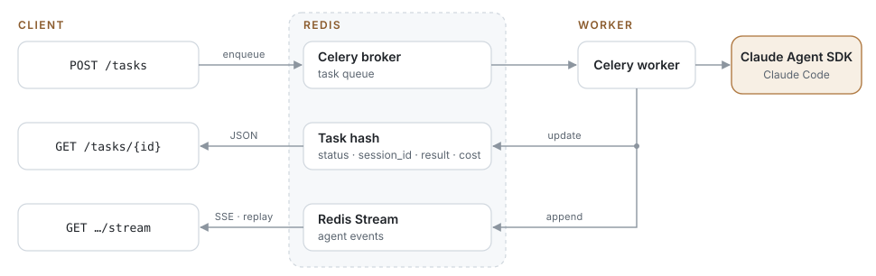

# rubens-atelier

**English** · [Русский](docs/readme.ru.md)

A software factory in the spirit of Rubens' workshop. Claude Code agents work as apprentices: they plan, implement, pass CI and open the PR. You are the master who reviews it and signs off with a merge. It works on GitHub issues and on projects built from scratch.

Under the hood it is an HTTP service that runs Claude Code ([Claude Agent SDK](https://code.claude.com/docs/en/agent-sdk)) as long-running background tasks on FastAPI, Celery and Redis.

The core flow: an agent picks up a GitHub issue, implements it, runs the checks, pushes a branch and opens a PR.

<p align="center"></p>

## Running

```bash
cp .env.example .env          # ANTHROPIC_API_KEY, HARNESS_API_TOKEN, HARNESS_GITHUB_TOKEN
docker compose up -d --build  # redis, postgres, migrate (one-off), api :8000, worker, beat
```

Board: http://localhost:8000/board (enter the `HARNESS_API_TOKEN` token in the field on the page).

The agent inside the container needs `ANTHROPIC_API_KEY`. You can set `CLAUDE_CODE_OAUTH_TOKEN` instead; `claude setup-token` issues one. The login from the host keychain does not reach the container.

Local development: `make dev` starts Redis and Postgres in Docker, migrates the schema (`make migrate`), then the api, worker and beat on the host (Ctrl-C stops all three). See `make help` for the other targets.

Locally without Docker, with your own Redis and Postgres:

```bash
uv sync
uv run python -m app.migrate                                    # schema up to date before anything starts
uv run uvicorn app.api:app --reload
uv run celery -A app.celery_app worker -l info --pool threads   # prefork+spawn does not work on macOS
uv run celery -A app.celery_app beat -l info
uv run pytest
```

### Board (web/)

The board is a Vue 3 + Vite + TypeScript app in `web/`. It needs Node 22 and pnpm (`corepack enable` provides the version pinned in `web/package.json`). `vite build` writes it to `app/static/dist/` (not committed), and `GET /board` serves it from there. Without a build `/board` shows a page asking to run `make web-build`; the API and the Python tests do not need Node.

- `make web-build`: install the dependencies and build the board. `make dev` runs it when `app/static/dist/` is missing; after changing `web/` rebuild or use the dev server.
- `make web-dev`: Vite dev server with hot reload at http://localhost:5173/board/. API requests go to http://localhost:8000, so run `make api` (or `make dev`) next to it.
- `make web-test`: type check (`vue-tsc --noEmit`) and unit tests (Vitest). Inside `web/`: `pnpm typecheck`, `pnpm test`.

The header's theme switch (Auto, Day, Midnight) is remembered per browser. Auto follows the OS colour scheme; Day and Midnight pin the light and dark palette.

The Docker image builds the board itself in a Node stage.

## API

| Method | Path | |
|---|---|---|
| `POST` | `/tasks` | Arbitrary task (`prompt`, optionally `repo_url`, `verify_command`, `model`, `effort`, `allowed_tools`, `max_budget_usd`, …) |
| `POST` | `/issues/run` | `{repo, number, verify_command?, prompt?}`: work on an issue from start to PR |
| `GET` | `/tasks/{id}` | Status, result, cost, `session_id`, `pr_url` |
| `GET` | `/tasks/{id}/stream` | SSE: history and live events until the task finishes, supports `Last-Event-ID` |
| `GET` | `/tasks/{id}/events?after=` | The same events, paginated |

On the board, **Session** (in a story's "Now" block and next to each run) shows an agent run's full session: prompt, text, thinking, tool calls with their results, verify output and the result. It reads `/tasks/{id}/stream` and updates live until the run ends, reconnecting from the last event if the connection drops. Event strings are clipped at 8000 characters. Factory runs stay viewable after Redis expires them, from the Postgres archive (see below).
| `POST` | `/tasks/{id}/cancel` | Cancel: a queued task is removed at once, a running one stops within about 2 seconds |
| `GET` | `/tasks?status=` | Task list |

Follow-up: `POST /tasks {"prompt": "...", "parent_task_id": "<id>"}` continues the same Claude session in the same workspace. For an issue task it pushes to the same branch, and the PR updates.

```bash
curl -X POST localhost:8000/issues/run -H "Authorization: Bearer $HARNESS_API_TOKEN" \
  -H 'content-type: application/json' \
  -d '{"repo": "acme/app", "number": 42, "verify_command": "make test"}'
```

## Factory: projects, board, workflows

The factory runs on top of tasks. A **project** is a tenant with its own repository and its own `verify_command`. A project holds **work items** (epic, story, task), and each item moves through its own **workflow**.

A workflow is a deterministic state machine in [workflows/](workflows/). The agent does not choose the next step. It returns a verdict (an enum via structured output), and `next` maps that verdict to the next state. State types:

| | |
|---|---|
| `agent` | a role from [prompts/](prompts/)`<role>.md` works in the item's workspace; options `verify`, `resume` (continue its previous session), `verdicts`, `disallowed_tools` |
| `action` | a built-in harness step, e.g. `open_pr` |
| `check` | an external condition evaluated without holding a worker, on GitHub webhooks and by beat; currently `ci` |
| `human` | a request to the inbox with answer options; the answer moves the item on |
| `terminal` | `succeeded`, `failed` or `cancelled` |

`max_visits` and `on_exhausted` guard against endless loops, such as implement ⇄ review ping-pong. If a verdict is missing from `next`, the item goes to `next.error`, and if that is missing too, to `failed`.

An agent run that ends without a result gives its failure reason as the verdict: `turn_limit`, `budget`, `model_error`, `verify_failed`, `timeout`, `crashed`, `workspace`, `restart_limit` (see `FailureReason` in `app/models.py`). An agent state can route any of them in `next`; the rest go to `next.error` as before. In `story.yaml` an implementer that runs out of turns continues its session in another `implement` visit, bounded by `max_visits`. The reason is also stored on the harness task (`failure_reason` in `/tasks/{id}` and in the final `status` event).

[workflows/story.yaml](workflows/story.yaml): `plan` (read-only) → `implement` (with verify) → `sync_base` → `review` (fresh session, no Write/Edit) → `publish` (push + PR) → `ci` → `merge` → `awaiting_merge` (human). With the project's `auto_merge` on, `merge` merges the reviewed, green PR itself and the story is done; otherwise, or when GitHub refuses the merge (branch protection, conflicts), the PR waits for a human, and the `merge` artifact says why. `changes_requested` sends the item back to `implement`, and the implementer continues its session with the review comments.

**sync_base** merges the latest base branch into the story's branch, so stories running in parallel build on each other's merged work and their PRs don't conflict. It merges rather than rebases, so reviewed history stays intact. On a conflict the merge is left in progress and the story goes back to `implement`; the `sync_base` artifact lists the conflicted files. The implementer resolves them and commits, and then the story goes through `sync_base` and review again. In `awaiting_merge`, the `update` option runs `sync_base` for an open PR when the base branch has moved on or GitHub reports conflicts.

The planner writes a `planner` artifact: approach, files, test plan, risks. The implementer follows the plan, and the reviewer checks the result against it. If human decisions are needed (`needs_clarification`), the item goes to `clarify`. The human's answer sends it back to `plan`, and the planner continues its session with the answer. If a story does not fit in one PR (`too_big`), it goes to `needs_human` with a proposed split; from there it can be sent to `replan` with a comment. The plan is approved without a human; if you want one, make a workflow variant with an `approve_plan` state.

**CI gate.** `check: ci` looks at GitHub check runs and commit statuses on the PR's pushed head commit when a webhook reports a finished check (see [GitHub webhook](#github-webhook)), and in any case every `HARNESS_CHECKS_POLL_SECONDS` (`HARNESS_CHECKS_FALLBACK_POLL_SECONDS` with webhooks on). If something fails, the item goes back to `implement`. The `ci` artifact contains the names of the failed checks, links and the tail of the GitHub Actions log. After the fix, the same push updates the PR. If no checks appear within `grace_seconds`, the result is `no_checks`: in a story, such an item goes straight to merge. If there is no result within `timeout_seconds`, the item goes to a human.

Steps pass **artifacts** to each other: the implementer's summary, the review, human comments, errors. Each next prompt gets the latest version of every artifact. The workspace (a clone on branch `agent/<kind>-<id>`) is shared by all of an item's steps. When the item reaches a `succeeded` terminal state (the PR is merged), the engine enqueues `harness.cleanup_workspace` and the worker deletes the workspace. Failed and cancelled items keep it, because reopening them reuses it.

| Method | Path | |
|---|---|---|
| `POST` | `/projects` | `{slug, repo, base_branch?, verify_command?, auto_merge?}` |
| `PATCH` | `/projects/{slug}` | `{base_branch?, verify_command?, auto_merge?}`; `null` clears a value; `slug`, `repo` and `installation_id` cannot be changed |
| `POST` | `/projects/{slug}/items` | `{title, body, kind?, workflow?, parent_id?, issue?, blocked_by?, start?}`. `blocked_by` lists up to 20 items of the same project that must succeed before this one can start (`start` then answers 409 naming them; a failed or cancelled blocker keeps blocking until it is reopened and succeeds or removed from the list; a cycle is a 422). Dependents are not started automatically |
| `POST` | `/projects/{slug}/import-issues` | Put the repo's open GitHub issues (PRs left out, up to 1000) into the backlog as stories linked to their issue, so the PR closes it; nothing starts. An issue that already has an item in any state is skipped. Returns `{imported, skipped}`; the board's "Import issues" button calls it |
| `GET` | `/projects/{slug}/board` | Columns backlog, working, needs_human, done, failed. The done column holds the `done_limit` most recently updated items (query param, default 50, max 500); their total is in the `X-Done-Total` header |
| `GET` | `/projects/{slug}/inbox` | Open requests to a human |
| `GET` | `/items/{id}` | Item, transition history, runs, artifacts, open request |
| `PATCH` | `/items/{id}` | `{title?, body?, priority?, model?, blocked_by?}`, also on the board (**Edit**; the model through the **Model** picker, which saves right away). A step waiting for a slot starts with the changes, a running one picks them up from the next agent step; a new priority reorders the queue right away |
| `GET` | `/models` | The models offered by the board's picker (`HARNESS_MODELS`) and `HARNESS_DEFAULT_MODEL` |
| `POST` | `/items/{id}/start`, `/items/{id}/cancel` | |
| `POST` | `/items/{id}/exec` + `GET /items/{id}/exec/{exec_id}` | Run a shell command in the story's workspace (board terminal). Off by default: needs `HARNESS_TERMINAL_ENABLED=true` and `HARNESS_API_TOKEN`; refused while an agent works there; runs on the worker, without `HARNESS_*` in its environment, killed after `HARNESS_TERMINAL_TIMEOUT_SECONDS` |
| `GET` | `/workspaces?size=&phase=&project=` | Every workspace on the volume: the story or task that owns it, size, `phase` (`orphan`, `finished`, `failed`, `idle`, `busy`) and whether it is `removable`. `size=false` skips the disk usage |
| `DELETE` | `/workspaces/{id}` | Remove one workspace (story or task id). 409 while an agent, an action or a terminal command uses it or a person is about to continue in it; a failed story loses unpushed commits. The worker deletes it (the API's volume is read-only), so list again to see the result |
| `POST` | `/workspaces/prune` | `{older_than_hours?, include_failed?, dry_run?}`: remove the workspaces of finished and deleted stories and tasks; `include_failed` adds failed, cancelled and backlog ones. Set `HARNESS_WORKSPACE_TTL_HOURS` to do the first part hourly by itself |
| `POST` | `/items/{id}/open-pr` | Push the branch and open (or update) the PR now, skipping review and CI; a running agent is cancelled |
| `POST` | `/requests/{id}/answer` | `{option, comment?}`; the comment becomes an artifact for the next agent |
| `GET` | `/scheduler` | Busy slots, queue, capacity and its reason, subscription window state |
| `POST` | `/scheduler/pause`, `/scheduler/resume` | Stop or resume handing out new agent steps; running ones finish |
| `PATCH` | `/scheduler/limits` | `{max_agents?, max_agents_per_project?, force?}`: change the slot limits without a restart; `DELETE` returns to the settings |
| `POST` | `/github/webhook` | GitHub events (signed with `HARNESS_GITHUB_WEBHOOK_SECRET`, not the bearer token): re-check the items waiting on that commit or PR, see [GitHub webhook](#github-webhook) |

The board's **Workspaces** button shows the list and runs the cleanup with a preview first.

Project settings can also be edited on the board (**Settings**). A changed `verify_command` applies from the next agent step of every story, including running ones. A changed `base_branch` applies only to stories that have not created their workspace yet; started ones keep their base.

**Scheduler.** Agent steps do not go to Celery right away; they wait in a priority queue: higher item `priority` first, FIFO on ties. A step is handed out only when a slot is free: at most `HARNESS_MAX_AGENTS` in total and at most `HARNESS_MAX_AGENTS_PER_PROJECT` per project. Both limits can be changed on the fly, in the board header (**slots**, **per project**) or via `PATCH /scheduler/limits`; the override lives in Redis and applies to every dispatcher. A raised limit hands out waiting steps right away; agents above a lowered one finish their step. The pace follows the subscription windows that Claude Code reports through `rate_limit` events (status, utilization, reset time):
- `rejected` or utilization ≥ `HARNESS_QUOTA_PAUSE_AT` → no new steps until the window resets;
- utilization ≥ `HARNESS_QUOTA_THROTTLE_AT` or `allowed_warning` → one agent;
- weekly windows are not spent faster than the week goes by: allowed usage is the elapsed share of the week plus `HARNESS_QUOTA_PACE_SLACK`.

**force** (board header, or `force: true` in `PATCH /scheduler/limits`) keeps the slot limit through the drop to one agent and past `HARNESS_QUOTA_PAUSE_AT`. Only a window Claude Code reports as `rejected` still stops dispatch: runs would only hit the limit and go back to the queue.

A run that hits the limit is not a work failure. The step returns to the queue without escalation and continues the same session after the window resets. Action and check steps do not use Claude and bypass the scheduler. Celery worker concurrency must be at least `HARNESS_MAX_AGENTS` (and any limit set on the fly); in compose it is 6.

Reliability. Every transition is a compare-and-set on `work_items.version`. A worker step (`harness.step`) and a human request are bound to the item's version, so a redelivery, a double click or a stale answer moves nothing. An agent step runs as a regular harness task, with its events (`/tasks/{task_id}/stream`), cancellation, lease and verify loop. `harness.reconcile` in beat re-enqueues steps that lost their enqueue or whose worker died before reporting a verdict.

Factory state lives in Postgres. Redis still holds the queue, agent events and leases. When an agent step finishes, its task and full event stream are archived to Postgres (`task_transcripts`, keyed by `runs.task_id`), so `/tasks/{id}`, `/tasks/{id}/events` and `/tasks/{id}/stream` keep serving a run's transcript after Redis has expired it. Ad-hoc `/tasks` runs are not archived. The schema is versioned with Alembic (`migrations/versions/`, applied revision in `alembic_version`). `python -m app.migrate` (`make migrate`, the one-off `migrate` service in compose) runs `alembic upgrade head` before the api, worker and beat start; they do not touch the schema themselves. A database created before Alembic (tables, no `alembic_version`) is stamped at revision `0001` first and then upgraded; if it lacks a column of that revision, the command stops instead. To change the schema: edit the models in `app/db.py`, `make migrate`, `make revision m="what changed"`, then review the generated file (autogenerate misses renames and data backfills). Tests build the schema with `create_all`; `tests/test_db.py` fails when the models and the migrations disagree.

## How the issue flow works

1. **Trigger.** A task is created by `POST /issues/run` or by beat, which polls `HARNESS_ISSUE_REPOS` every `HARNESS_ISSUE_POLL_SECONDS` and picks up issues labelled `agent`. Only collaborators with triage rights can set labels, so an outsider cannot point the agent at their own text.
2. **Preparation.** The harness clones the repository and creates branch `agent/issue-N`. The label changes to `agent:in-progress`.
3. **Agent.** Gets the issue text, its comments and a "definition of done": tests, linters, docs, commits. The agent is not allowed to push.
4. **Verify.** The harness runs `verify_command` itself. If it fails, the session resumes with its output, up to `verify_attempts` times.
5. **Publish.** The harness pushes the branch (`--force-with-lease`), opens a PR with `Closes #N`, comments on the issue and sets the `agent:pr-open` label. On error it sets `agent:failed` and comments with the reason.

The push goes to the PR branch, not to `main`: CI and review confirm production readiness.

## Reliability

- `acks_late` + `prefetch=1`: if a worker dies, the message is redelivered. Redelivery does not rerun the agent in the same task: an atomic claim (Lua) moves such a task to `failed: worker lost`.
- A factory agent step whose worker died is not escalated: the cut run is dropped and the step runs again, resuming the cut session with a prompt to check the workspace and carry on. After `HARNESS_RESTART_LIMIT` (3) such restarts in one state visit, the next crash ends the step with `restart_limit`, which goes to `next.error` (in a story, a human).
- Lease with heartbeat and a reaper in beat: tasks of dead workers are marked failed in about 30 seconds rather than after `visibility_timeout`.
- `session_id` is saved right at startup. A cancelled, failed or timed-out task can be continued via `parent_task_id`.
- Finished tasks and their events are kept in Redis for `HARNESS_RESULT_TTL_SECONDS` (7 days by default); factory runs are archived to Postgres before that.

## GitHub App

Instead of a single PAT, the project can work through a GitHub App: access only to the repositories selected at install time, and 1-hour tokens.

1. Create an App at github.com/settings/apps/new: permissions Contents, Issues, Pull requests (read/write), Checks and Actions (read), access "Only on this account". Set Setup URL to `<host>/board` and enable "Redirect on update".
2. Generate a private key and set `HARNESS_GITHUB_APP_ID`, `HARNESS_GITHUB_APP_SLUG`, `HARNESS_GITHUB_APP_PRIVATE_KEY` (or `_FILE`).
3. On the board, click "+ project", then "Install the app / change repositories". After installing, click "refresh", pick the installation and the repository.

A token is issued for one project repository and reissued 5 minutes before it expires. The lifetime (1 hour) is set by GitHub and cannot be changed. Projects without an installation use `HARNESS_GITHUB_TOKEN`. The issue poller (`HARNESS_ISSUE_REPOS`) and `/issues/run` work only with it for now.

## GitHub webhook

Without a webhook, beat asks GitHub about every item in `ci` and `awaiting_merge` every `HARNESS_CHECKS_POLL_SECONDS` (30s), 120–240 requests per hour per item, which runs into the rate limit with many stories. With one, GitHub reports events and only the items they concern are re-checked:

1. Pick a random secret (`openssl rand -hex 32`) and set `HARNESS_GITHUB_WEBHOOK_SECRET`.
2. Payload URL `<host>/github/webhook`, content type `application/json`, the same secret. Events: Check runs, Check suites, Statuses, Pull requests.
   - GitHub App: the App's settings → Webhook (Active). Statuses need the extra permission "Commit statuses: read".
   - PAT: the repository's Settings → Webhooks.
3. Restart beat: polling becomes a fallback every `HARNESS_CHECKS_FALLBACK_POLL_SECONDS` (300s by default) for lost deliveries and for `no_checks`/`timeout`, which therefore land up to that much late.

Deliveries are verified by their `X-Hub-Signature-256` HMAC rather than the API token; an event only triggers a re-check against GitHub, never a verdict by itself. Without a secret the endpoint answers 404.

## Security

The agent has Bash, and issue text can come from an outsider. Keep in mind:
- the worker runs in a container as an unprivileged user;
- the GitHub token (or the GitHub App private key) is used only by the harness: it is passed via `-c http.extraheader` rather than stored in `.git/config`, and is removed from the worker processes' env;
- `HARNESS_BASH_ALLOWED_COMMANDS` limits Bash to command prefixes (empty = any) and `HARNESS_SANDBOX=true` runs it in Claude Code's OS sandbox (writes only in the workspace); both are off by default;
- `allowed_tools`, `max_turns`, `max_budget_usd` and a timeout bound each task;
- for production, isolate each task: its own container or microVM, an egress filter. You can also enable `sandbox` in `ClaudeAgentOptions`.
