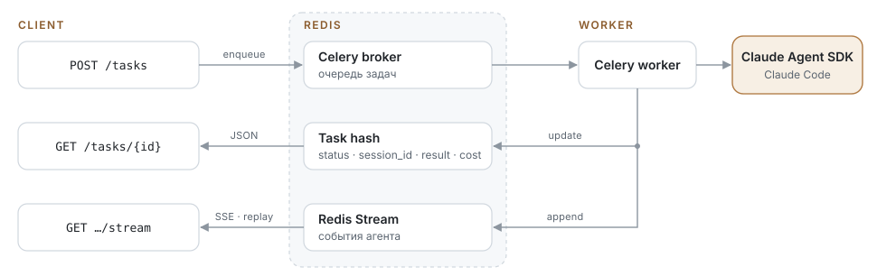

# rubens-atelier

[English](../README.md) · **Русский**

Software factory в духе мастерской Рубенса: агенты Claude Code работают подмастерьями (план, реализация, CI, PR), а мастер — человек — ревьюит и ставит подпись мержем. Работает и с GitHub issues, и для разработки с нуля.

HTTP-сервис для запуска Claude Code ([Claude Agent SDK](https://code.claude.com/docs/en/agent-sdk)) как долгих фоновых задач: FastAPI, Celery и Redis.

Главный сценарий: агент берёт issue из GitHub, реализует его, прогоняет проверки, пушит ветку и открывает PR.

<p align="center"></p>

## Запуск

```bash
cp .env.example .env          # ANTHROPIC_API_KEY, HARNESS_API_TOKEN, HARNESS_GITHUB_TOKEN
docker compose up -d --build  # redis, postgres, api :8000, worker, beat
```

Доска: http://localhost:8000/board (токен из `HARNESS_API_TOKEN` вводится в поле на странице).

Агенту в контейнере нужен `ANTHROPIC_API_KEY`. Вместо него можно указать `CLAUDE_CODE_OAUTH_TOKEN`, его выдаёт `claude setup-token`. Логин из keychain хоста в контейнер не попадает.

Локально без Docker, только с Redis:

```bash
uv sync
uv run uvicorn app.api:app --reload
uv run celery -A app.celery_app worker -l info --pool threads   # на macOS prefork+spawn не работает
uv run celery -A app.celery_app beat -l info
uv run pytest
```

### Доска (web/)

Доска: приложение на Vue 3 + Vite + TypeScript в `web/`. Нужны Node 22 и pnpm (`corepack enable` подставит версию из `web/package.json`). `vite build` пишет сборку в `app/static/dist/` (в git её нет), `GET /board` отдаёт её оттуда. Без сборки `/board` показывает страницу с просьбой выполнить `make web-build`; API и Python-тестам Node не нужен.

- `make web-build`: установить зависимости и собрать доску. `make dev` делает это сам, если `app/static/dist/` нет; после изменений в `web/` пересоберите или используйте dev-сервер.
- `make web-dev`: dev-сервер Vite с hot reload на http://localhost:5173/board/. Запросы к API идут на http://localhost:8000, поэтому рядом запустите `make api` (или `make dev`).
- `make web-test`: проверка типов (`vue-tsc --noEmit`) и юнит-тесты (Vitest). Внутри `web/`: `pnpm typecheck`, `pnpm test`.

Docker-образ собирает доску сам, в отдельной Node-стадии.

## API

| Метод | Путь | |
|---|---|---|
| `POST` | `/tasks` | Произвольная задача (`prompt`, опционально `repo_url`, `verify_command`, `model`, `effort`, `allowed_tools`, `max_budget_usd`, …) |
| `POST` | `/issues/run` | `{repo, number, verify_command?, prompt?}`: работа над issue от начала до PR |
| `GET` | `/tasks/{id}` | Статус, результат, стоимость, `session_id`, `pr_url` |
| `GET` | `/tasks/{id}/stream` | SSE: история и живые события до завершения задачи, поддерживает `Last-Event-ID` |
| `GET` | `/tasks/{id}/events?after=` | Те же события страницами |
| `POST` | `/tasks/{id}/cancel` | Отмена: задача из очереди снимается сразу, работающая останавливается в течение примерно 2 секунд |
| `GET` | `/tasks?status=` | Список задач |

Follow-up: `POST /tasks {"prompt": "...", "parent_task_id": "<id>"}` продолжает ту же Claude-сессию в том же workspace. Для issue-задачи он пушит в ту же ветку, и PR обновляется.

```bash
curl -X POST localhost:8000/issues/run -H "Authorization: Bearer $HARNESS_API_TOKEN" \
  -H 'content-type: application/json' \
  -d '{"repo": "acme/app", "number": 42, "verify_command": "make test"}'
```

## Фабрика: проекты, доска, workflow

Поверх задач работает фабрика. **Проект** — это тенант: свой репозиторий и своя `verify_command`. В проекте есть **work items** (epic, story, task), и каждый item идёт по своему **workflow**.

Workflow — это детерминированный конечный автомат в [workflows/](../workflows/). Агент не выбирает следующий шаг. Он возвращает вердикт (enum через structured output), и следующее состояние по этому вердикту определяет `next`. Типы состояний:

| | |
|---|---|
| `agent` | роль из [prompts/](../prompts/)`<role>.md` работает в workspace item'а; есть опции `verify`, `resume` (продолжить свою прошлую сессию), `verdicts`, `disallowed_tools` |
| `action` | встроенный шаг harness'а, например `open_pr` |
| `check` | внешнее условие, которое опрашивает beat, не занимая воркер; сейчас это `ci` |
| `human` | запрос во inbox с вариантами ответа; ответ продвигает item дальше |
| `terminal` | `succeeded`, `failed` или `cancelled` |

`max_visits` и `on_exhausted` защищают от бесконечных циклов, например от пинг-понга implement ⇄ review. Если вердикта нет в `next`, item уходит в `next.error`, а если нет и его, то в `failed`.

[workflows/story.yaml](../workflows/story.yaml): `plan` (только чтение) → `implement` (с verify) → `sync_base` → `review` (свежая сессия, без Write/Edit) → `publish` (push + PR) → `ci` → `awaiting_merge` (человек). `changes_requested` возвращает item в `implement`, и implementer продолжает свою сессию с замечаниями ревью.

**sync_base** вливает свежую базовую ветку в ветку story. Так параллельные story строятся поверх уже вмёрженной работы друг друга, и их PR не конфликтуют. Используется merge, а не rebase, поэтому проверенная история не переписывается. При конфликте merge остаётся незавершённым, и story возвращается в `implement`; артефакт `sync_base` перечисляет конфликтующие файлы. Implementer разрешает конфликты и коммитит, после чего story снова проходит `sync_base` и ревью. В `awaiting_merge` вариант `update` запускает `sync_base` для открытого PR, когда базовая ветка ушла вперёд или GitHub сообщает о конфликтах.

Планировщик пишет артефакт `planner`: подход, файлы, тест-план, риски. Implementer следует этому плану, а ревьюер сверяет с ним результат. Если нужны решения человека (`needs_clarification`), item идёт в `clarify`. Ответ человека возвращает его в `plan`, и планировщик продолжает свою сессию уже с ответом. Если story не помещается в один PR (`too_big`), она уходит в `needs_human` с предложением, как её разбить; оттуда её можно отправить в `replan` с комментарием. План утверждается без человека, а если он нужен, можно сделать отдельный вариант workflow с состоянием `approve_plan`.

**CI-gate.** `check: ci` раз в `HARNESS_CHECKS_POLL_SECONDS` смотрит GitHub check runs и commit statuses на запушенном head-коммите PR. Если что-то упало, item возвращается в `implement`. Артефакт `ci` содержит имена упавших проверок, ссылки и хвост лога GitHub Actions. После фикса PR обновляется тем же push'ем. Если за `grace_seconds` не появилось ни одной проверки, это `no_checks`: в story такой item сразу идёт на merge. Если за `timeout_seconds` нет результата, item уходит к человеку.

Шаги передают друг другу **артефакты**: итог implementer'а, ревью, комментарии человека, ошибки. Каждый следующий промпт получает последнюю версию каждого артефакта. Workspace (clone и ветка `agent/<kind>-<id>`) общий для всех шагов item'а.

| Метод | Путь | |
|---|---|---|
| `POST` | `/projects` | `{slug, repo, base_branch?, verify_command?}` |
| `PATCH` | `/projects/{slug}` | `{base_branch?, verify_command?}`; `null` очищает значение; `slug`, `repo` и `installation_id` менять нельзя |
| `POST` | `/projects/{slug}/items` | `{title, body, kind?, workflow?, parent_id?, issue?, start?}` |
| `POST` | `/projects/{slug}/import-issues` | Кладёт открытые GitHub issues репозитория (без PR, до 1000) в backlog историями, привязанными к своему issue, так что PR его закроет; ничего не запускается. Issue, у которого уже есть элемент в любом состоянии, пропускается. Возвращает `{imported, skipped}`; его вызывает кнопка «Import issues» на доске |
| `GET` | `/projects/{slug}/board` | Колонки backlog, working, needs_human, done, failed |
| `GET` | `/projects/{slug}/inbox` | Открытые запросы к человеку |
| `GET` | `/items/{id}` | Item, история переходов, запуски, артефакты, открытый запрос |
| `PATCH` | `/items/{id}` | `{title?, body?, priority?, model?}`, также в борде (**Edit**). Шаг, ждущий слот, стартует уже с изменениями, работающий подхватит их со следующего agent-шага; новый priority сразу переставляет его в очереди |
| `POST` | `/items/{id}/start`, `/items/{id}/cancel` | |
| `POST` | `/items/{id}/exec` + `GET /items/{id}/exec/{exec_id}` | Выполнить shell-команду в рабочей копии задачи (терминал доски). По умолчанию выключено: нужны `HARNESS_TERMINAL_ENABLED=true` и `HARNESS_API_TOKEN`; отказ, пока там работает агент; выполняется на воркере без `HARNESS_*` в окружении, убивается через `HARNESS_TERMINAL_TIMEOUT_SECONDS` |
| `POST` | `/items/{id}/open-pr` | Запушить ветку и открыть (или обновить) PR сразу, минуя review и CI; работающий агент отменяется |
| `POST` | `/requests/{id}/answer` | `{option, comment?}`; комментарий становится артефактом для следующего агента |
| `GET` | `/scheduler` | Занятые слоты, очередь, ёмкость и её причина, состояние окон подписки |
| `POST` | `/scheduler/pause`, `/scheduler/resume` | Остановить или возобновить выдачу новых agent-шагов; уже работающие доработают |
| `PATCH` | `/scheduler/limits` | `{max_agents?, max_agents_per_project?, force?}`: поменять лимиты слотов без перезапуска; `DELETE` возвращает значения из настроек |

Настройки проекта можно менять и на доске (**Settings**). Новая `verify_command` действует со следующего agent-шага каждой story, в том числе уже запущенной. Новая `base_branch` действует только на story, у которых ещё нет workspace; уже начатые сохраняют свою базу.

**Scheduler.** Agent-шаги не уходят в Celery сразу, а ждут в очереди с приоритетом: сначала больший `priority` item'а, при равном — FIFO. Выдаются, только если есть слот: всего не больше `HARNESS_MAX_AGENTS`, на один проект не больше `HARNESS_MAX_AGENTS_PER_PROJECT`. Оба лимита можно менять на лету: в шапке борда (**slots**, **per project**) или через `PATCH /scheduler/limits`; переопределение хранится в Redis и действует для всех диспетчеров. Поднятый лимит сразу выдаёт ждущие шаги; агенты сверх сниженного доделывают свой шаг. Темп задают окна подписки, о которых Claude Code сообщает `rate_limit`-событиями (статус, загрузка, время сброса):
- `rejected` или загрузка ≥ `HARNESS_QUOTA_PAUSE_AT` → новых шагов нет до сброса окна;
- загрузка ≥ `HARNESS_QUOTA_THROTTLE_AT` или `allowed_warning` → один агент;
- недельные окна не расходуются быстрее, чем идёт неделя: допустимо использовать прошедшую долю недели плюс `HARNESS_QUOTA_PACE_SLACK`.

**force** (в шапке борда или `force: true` в `PATCH /scheduler/limits`) сохраняет лимит слотов вместо сброса до одного агента и пускает дальше `HARNESS_QUOTA_PAUSE_AT`. Останавливает выдачу только окно, которое Claude Code сообщил как `rejected`: запуски только упрутся в лимит и вернутся в очередь.

Если запуск упёрся в лимит, это не ошибка работы. Шаг возвращается в очередь без эскалации и после сброса окна продолжает ту же сессию. Action- и check-шаги Claude не используют и идут мимо scheduler'а. Concurrency воркера Celery должна быть не меньше `HARNESS_MAX_AGENTS` (и лимита, выставленного на лету); в compose она равна 6.

Надёжность. Каждый переход — это compare-and-set по `work_items.version`. Шаг воркера (`harness.step`) и запрос к человеку привязаны к версии item'а, поэтому повторная доставка, двойной клик или устаревший ответ ничего не сдвигают. Agent-шаг выполняется как обычная harness-задача: с её событиями (`/tasks/{task_id}/stream`), отменой, lease и verify-циклом. `harness.reconcile` в beat заново ставит в очередь шаги, которые потеряли enqueue или воркер которых упал до того, как сообщил вердикт.

Состояние фабрики хранится в Postgres. Redis по-прежнему держит очередь, события агентов и lease. Когда agent-шаг завершается, его задача и весь поток событий архивируются в Postgres (`task_transcripts`, ключ — `runs.task_id`), поэтому `/tasks/{id}`, `/tasks/{id}/events` и `/tasks/{id}/stream` отдают транскрипт run'а и после того, как Redis его удалил. Разовые задачи `/tasks` не архивируются. Схема создаётся при старте API (`create_all`); Alembic появится вместе с первой миграцией.

## Как работает issue-флоу

1. **Триггер.** Задачу ставит `POST /issues/run` или beat, который раз в `HARNESS_ISSUE_POLL_SECONDS` опрашивает `HARNESS_ISSUE_REPOS` и забирает issues с меткой `agent`. Ставить метки могут только участники с правами triage, поэтому любой посторонний не сможет натравить агента на свой текст.
2. **Подготовка.** Harness клонирует репозиторий и создаёт ветку `agent/issue-N`. Метка меняется на `agent:in-progress`.
3. **Агент.** Получает текст issue, комментарии к нему и «definition of done»: тесты, линтеры, документация, коммиты. Делать push агенту запрещено.
4. **Verify.** Harness сам запускает `verify_command`. Если команда упала, сессия возобновляется с её выводом, до `verify_attempts` раз.
5. **Публикация.** Harness пушит ветку (`--force-with-lease`), открывает PR с `Closes #N`, оставляет комментарий в issue и ставит метку `agent:pr-open`. При ошибке ставится `agent:failed` и пишется комментарий с причиной.

Push идёт в ветку с PR, а не в `main`: production-готовность подтверждают CI и ревью.

## Надёжность

- `acks_late` + `prefetch=1`: если воркер упал, сообщение доставляется повторно. Повторная доставка не перезапускает агента: атомарный claim (Lua) переводит такую задачу в `failed: worker lost`.
- Lease с heartbeat и reaper в beat: задачи упавших воркеров помечаются failed примерно через 30 секунд, а не через `visibility_timeout`.
- `session_id` сохраняется сразу при старте. Отменённую, упавшую или зависшую по таймауту задачу можно продолжить через `parent_task_id`.
- Готовые задачи и их события хранятся в Redis `HARNESS_RESULT_TTL_SECONDS` (по умолчанию 7 дней); run'ы фабрики до этого архивируются в Postgres.

## GitHub App

Вместо одного PAT проект может работать через GitHub App: доступ только к репозиториям, выбранным при установке, и токены на 1 час.

1. Создайте App на github.com/settings/apps/new: права Contents, Issues, Pull requests (read/write), Checks и Actions (read), доступ «Only on this account». В Setup URL укажите `<host>/board` и включите «Redirect on update».
2. Сгенерируйте private key и задайте `HARNESS_GITHUB_APP_ID`, `HARNESS_GITHUB_APP_SLUG`, `HARNESS_GITHUB_APP_PRIVATE_KEY` (или `_FILE`).
3. На доске нажмите «+ project», затем «Install the app / change repositories». После установки нажмите «refresh», выберите установку и репозиторий.

Токен выпускается на один репозиторий проекта и перевыпускается за 5 минут до истечения. Срок жизни (1 час) задаёт GitHub, изменить его нельзя. Проекты без установки используют `HARNESS_GITHUB_TOKEN`. Поллер issues (`HARNESS_ISSUE_REPOS`) и `/issues/run` пока работают только с ним.

## Безопасность

У агента есть Bash, а текст issue может прийти от постороннего человека. Учитывайте следующее:
- воркер работает в контейнере под непривилегированным пользователем;
- GitHub-токен (или private key GitHub App) используется только harness'ом: он передаётся через `-c http.extraheader`, а не хранится в `.git/config`, и удаляется из env воркер-процессов;
- `allowed_tools`, `max_turns`, `max_budget_usd` и timeout ограничивают каждую задачу;
- для продакшена стоит изолировать каждую задачу отдельно: свой контейнер или microVM, egress-фильтр. Можно также включить `sandbox` в `ClaudeAgentOptions`.
